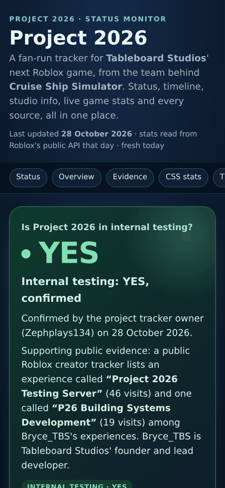
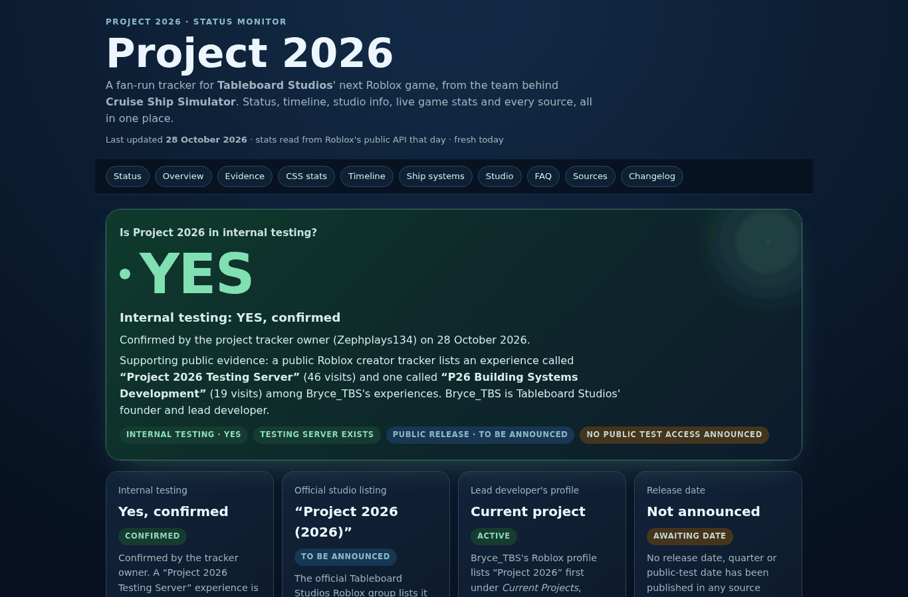

# Project 2026 Status Monitor

> **Internal testing: ✅ YES, confirmed** · Public release: **To be announced** · Last updated **28 October 2026**

A fan-run, single-page status dashboard tracking **Project 2026**, the next Roblox game from **[Tableboard Studios](https://www.roblox.com/communities/4795028/Tableboard-Studios)**, the studio behind **[Cruise Ship Simulator](https://www.roblox.com/games/17234598656/Cruise-Ship-Simulator)**.

It pulls together the project's status, an evidence board, a dated timeline, live Cruise Ship Simulator stats, known ship systems, the studio and team, an FAQ, and every source with the date it was read.

<p align="center">
  
  &nbsp;
  
</p>

---

## Live status

| Question | Status | Basis |
|---|---|---|
| Is Project 2026 in internal testing? | ✅ **YES, confirmed** | Confirmed by the tracker owner (Zephplays134), 28 Oct 2026. Supported by a public listing of a **“Project 2026 Testing Server”** experience (46 visits) under Bryce_TBS ([rotraces.com](https://rotraces.com/Bryce_TBS)) |
| Is it officially listed by the studio? | ✅ Yes | Official group: *“Project 2026 (2026) · To be announced.”* |
| Is it the lead developer's current project? | ✅ Yes | Bryce_TBS's Roblox profile lists it first under *Current Projects* |
| Building-systems dev place | ✅ Exists | “P26 Building Systems Development” (19 visits), same source |
| Public release date | ⏳ Not announced | The listing only says “(2026)” |
| Public / open test access | ⏳ Not announced | No public test access announced |
| Elevators / PA / walkable decks | ❔ Not publicly confirmed | No public source mentions them for Project 2026 yet |

> **About the confirmation.** No official public statement about testing (group shout, Discord post, game-page note) was found as of 28 Oct 2026. The YES comes from the repository owner's confirmation, and the publicly listed testing server backs it up.

## Cruise Ship Simulator snapshot (28 Oct 2026)

Read from Roblox's public games API on 28 Oct 2026.

| Metric | Value |
|---|---|
| Visits | 6,263,487 |
| Favorites | 35,378 |
| Votes | 9,625 👍 / 2,797 👎 (77.5% liked) |
| Players online at read | 35 |
| Max players / server | 15 |
| Created | 21 Apr 2024 |
| Last updated | 26 Oct 2026 |
| Genre | Simulation › Vehicle Sim |
| Stage | “Currently in BETA stages and is a Work in Progress” |
| Tableboard Studios group members | 46,452 |

## Features of the dashboard

- **Headline status hero.** Big, unmistakable “YES” for internal testing, with its basis spelled out.
- **Status cards.** Testing, official listing, lead-dev profile, release date.
- **Evidence board.** Every signal tagged by source type: *Official*, *Third-party data* or *Owner-confirmed*.
- **CSS live stats.** Visits, favorites, like ratio, group size, game metadata.
- **Timeline.** Studio history from Cruise Line Simulator: Classic (2021) to today, dated from Roblox's own records.
- **Elevators & ship systems.** What's known in CSS today (game passes, fleet) next to what's still unconfirmed for Project 2026.
- **Studio & team.** Games with status and visits; team roles from the in-game “Meet the devs” badges.
- **FAQ**, **dated sources**, **changelog**, and a “last updated” age counter.
- **Single file, no dependencies.** Pure HTML + CSS + about 5 lines of JS. Mobile-first, dark theme, works offline, respects reduced motion.

## How to view

**Locally:** download or clone the repo and open `index.html` in any browser.

```bash
git clone https://github.com/Zephplays134/Elevator202.git
cd Elevator202
open index.html        # macOS  (Windows: start index.html · Linux: xdg-open index.html)
```

**On the web with GitHub Pages:**

1. Go to **Settings → Pages** in this repository.
2. Under **Build and deployment**, set **Source** to *Deploy from a branch*.
3. Pick branch **`main`** and folder **`/ (root)`**, then **Save**.
4. After about a minute the site is live at **https://zephplays134.github.io/Elevator202/**

## Repository layout

```
Elevator202/
├── index.html                  # The dashboard (single file)
├── README.md                   # This file
├── CHANGELOG.md                # Version history
├── GEMINI_STATUS_MONITOR.md    # Guide for AI-assisted status reviews
├── LICENSE                     # MIT
└── docs/
    ├── SOURCES.md              # Full source log with read dates and raw figures
    ├── UPDATING.md             # How to refresh the numbers and status
    ├── screenshot-mobile.png
    └── screenshot-desktop.png
```

## Sources

All read on **28 October 2026**. Full detail is in [`docs/SOURCES.md`](docs/SOURCES.md).

| Source | Type | What it showed |
|---|---|---|
| [Tableboard Studios Roblox group](https://www.roblox.com/communities/4795028/Tableboard-Studios) | Official | “Project 2026 (2026) To be announced.”, 46,452 members |
| [Bryce_TBS Roblox profile](https://www.roblox.com/users/127968748/profile) | Official | Project 2026 under Current Projects |
| [Cruise Ship Simulator](https://www.roblox.com/games/17234598656/Cruise-Ship-Simulator) | Official (Roblox API) | Stats, badges, game passes |
| [Rotraces: Bryce_TBS](https://rotraces.com/Bryce_TBS) | Third-party | “Project 2026 Testing Server” (46 visits), “P26 Building Systems Development” (19 visits) |
| [Studio projects page](https://sites.google.com/view/tableboardstudios/projects) | Official | Covers only CLS: A New Era and Classic (no Project 2026 yet) |
| [Rolimon's group page](https://www.rolimons.com/group/4795028) | Third-party | Mirrors the “To be announced” listing |
| Repository owner | Owner | Internal testing confirmed: YES |

Official channels to watch: [Discord](https://discord.com/invite/tableboardstudios) · [X @TBStudiosRBLX](https://x.com/TBStudiosRBLX) · [TikTok](https://www.tiktok.com/@tableboard_studios) · [YouTube: Bryce_TBS](https://www.youtube.com/@Bryce_TBS)

## Accuracy policy

1. Every number on the page comes from a page or API actually read, with the date. Nothing is estimated.
2. Each claim is tagged by source type: **Official**, **Third-party data** or **Owner-confirmed**.
3. Features (elevators, PA systems, etc.) stay **unconfirmed** until the studio shows them publicly.
4. Snapshots go stale, so every update bumps the “Last updated” date and adds a `CHANGELOG.md` entry.

## Contributing

Spotted a new announcement, a date or a feature reveal?

1. Open an **Issue** with the link and the date you saw it, **or**
2. Fork, edit `index.html` (and the status table above), add a line to `CHANGELOG.md`, and open a **Pull Request**.

Please link a source for every new fact. See [`docs/UPDATING.md`](docs/UPDATING.md) for where each number lives.

## Changelog

See [`CHANGELOG.md`](CHANGELOG.md). Latest: **v2.0.0 (28 Oct 2026)**: internal testing set to **YES**, plus a full redesign and much more detail.

## License & disclaimer

Code is released under the [MIT License](LICENSE).

This is an **unofficial fan project**. It is not affiliated with or endorsed by Tableboard Studios or Roblox Corporation. Game names, studio names and Roblox are the property of their owners.
